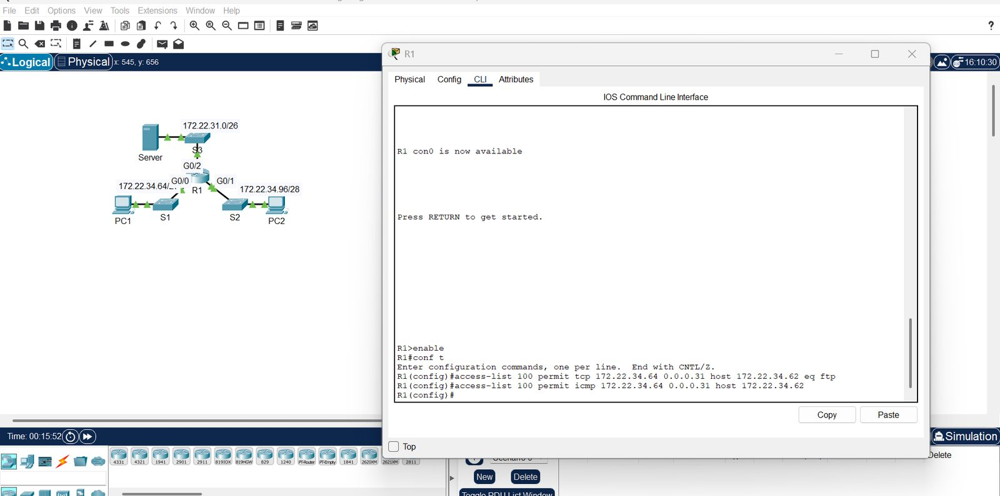
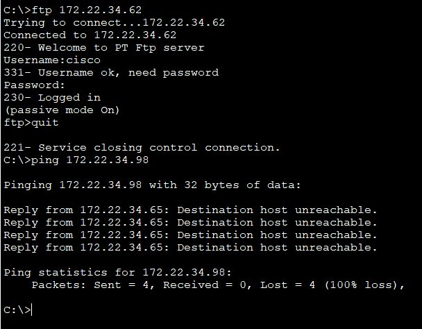
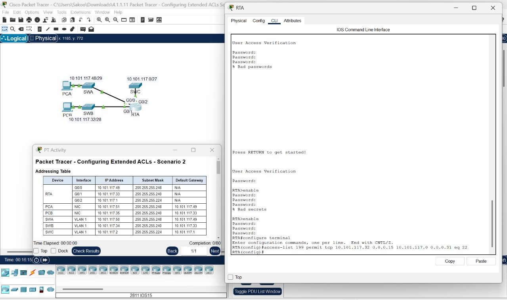
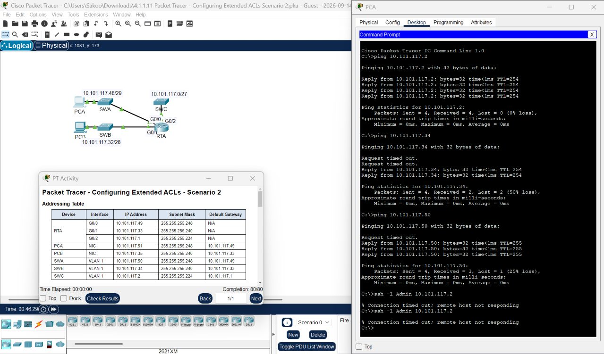
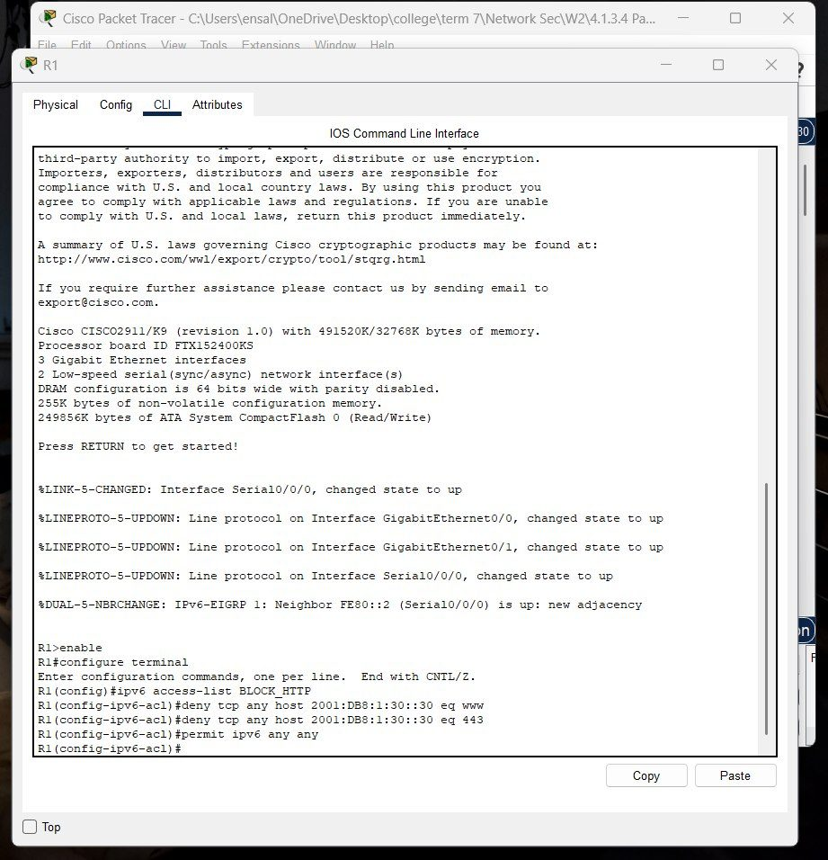
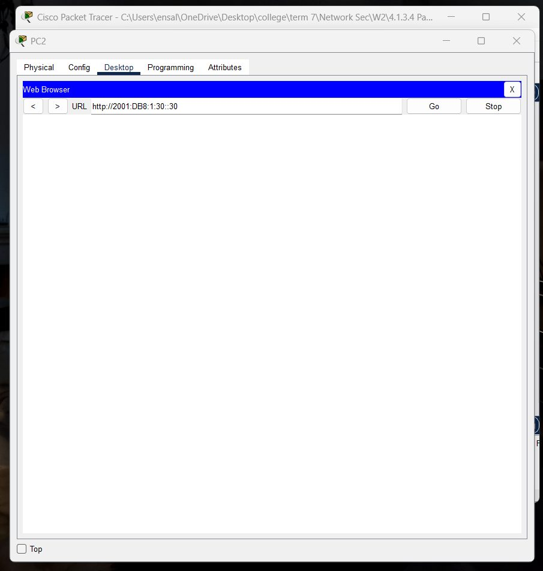
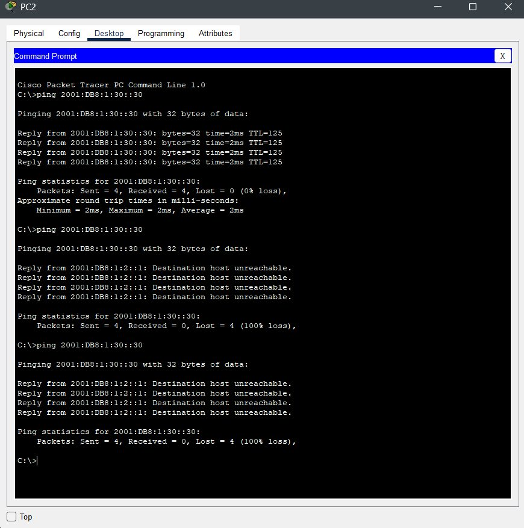

# Lab 01: Extended and IPv6 Access Control Lists

**Course:** CYS 502 Network Security | **Tool:** Cisco Packet Tracer | **Type:** Team lab

## Objective
Filter traffic precisely with extended IPv4 ACLs (numbered and named) and IPv6 ACLs, place them on the right interfaces, and verify that only the intended traffic passes.

## Scenario 1: Extended IPv4 ACLs

| Part | ACL type | Permitted traffic |
|---|---|---|
| 1 | Numbered extended | FTP and ICMP |
| 2 | Named extended | HTTP and ICMP |

Each ACL was configured, applied to the correct interface, and verified with traffic tests. In the verification, FTP to the permitted server succeeded, while ICMP to a host the ACL does not permit was blocked with *Destination host unreachable*.

| ACL configuration | Verification: FTP allowed, ping blocked |
|---|---|
|  |  |

## Scenario 2: Placement Matters

An extended ACL (199) was applied to restrict SSH access to a switch (SWC).

| ACL configuration | Verification |
|---|---|
|  |  |

**Finding:** PCA bypassed ACL 199 by SSHing first to SWB, which was allowed to reach SWC, and pivoting from there.

**Fix:** Instead of applying ACL 199 outbound on G0/2, apply it **inbound on G0/0 and G0/1**. Traffic is then filtered as it enters the router, which blocks the indirect path while still allowing SSH from the authorized 10.101.117.32/28 network.

## IPv6 ACLs

| Part | Goal |
|---|---|
| 1 | Block HTTP and HTTPS |
| 2 | Block ICMP |

| IPv6 ACL configuration | Web access blocked | ICMP blocked |
|---|---|---|
|  |  |  |

## Key Takeaways
- Extended ACLs filter by protocol, source, destination, and port, so place them close to the source.
- ACL placement and direction decide whether an attacker can pivot around a rule.
- IPv6 needs its own ACLs, because IPv4 rules do not apply to IPv6 traffic.
