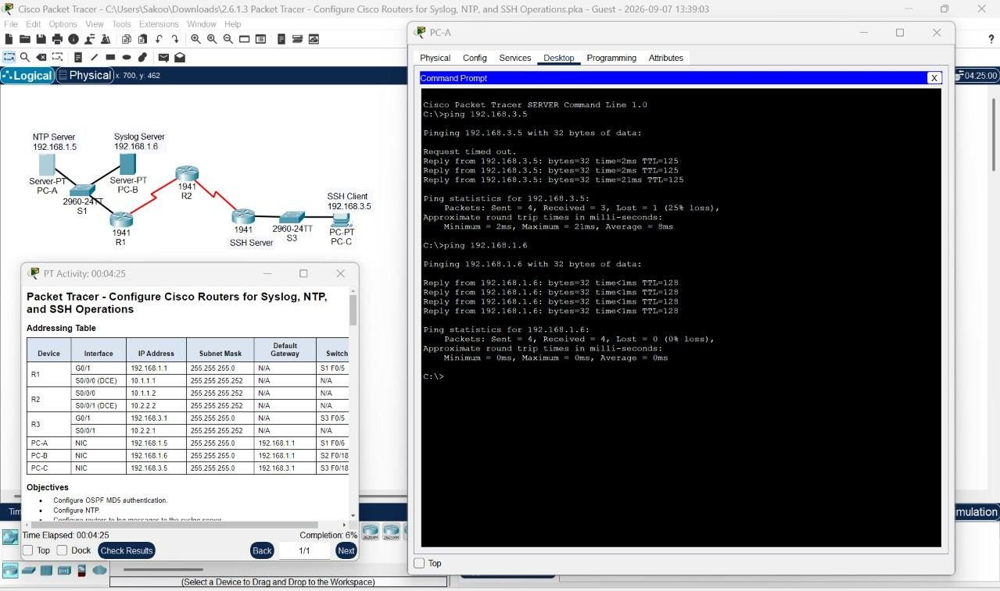
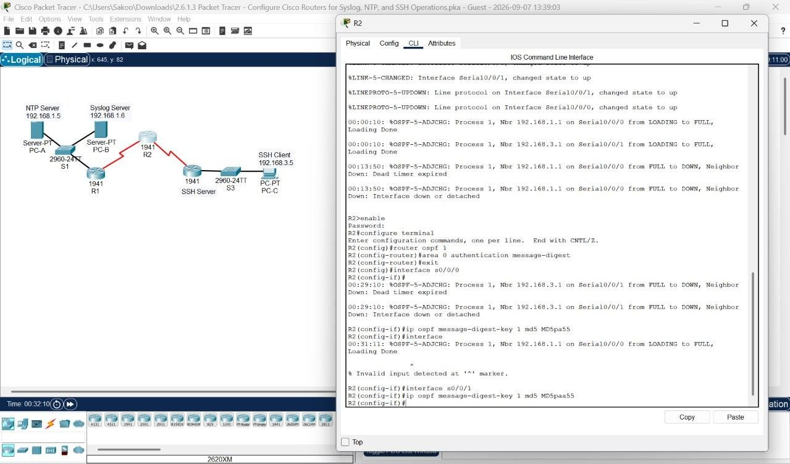
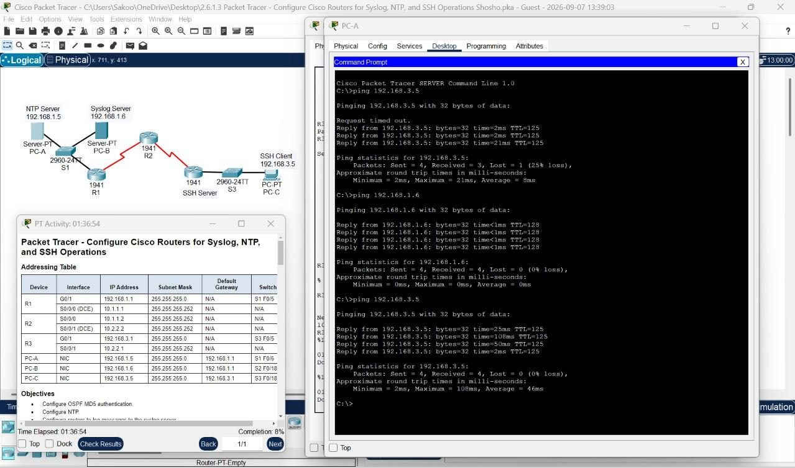
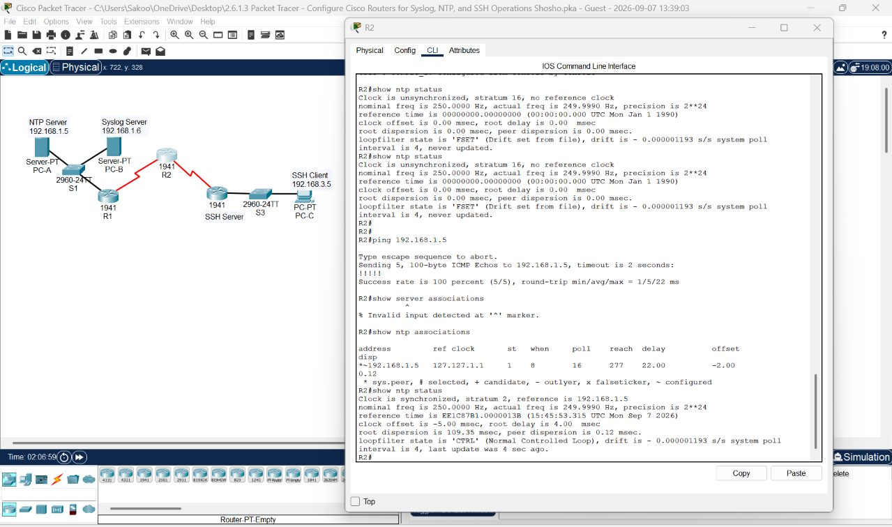
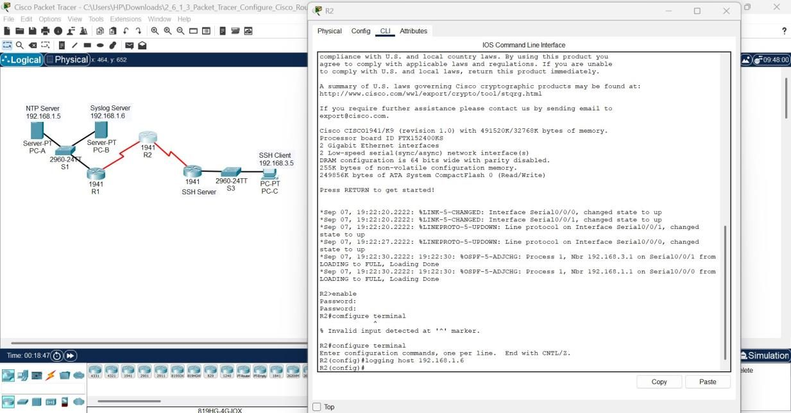
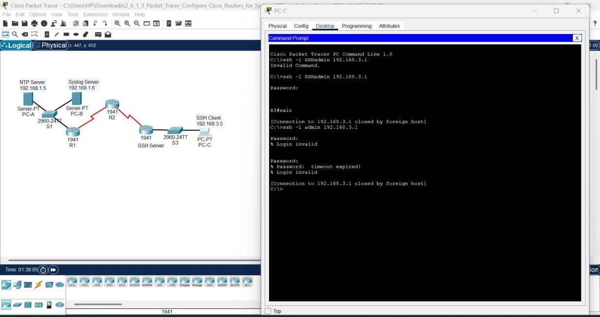
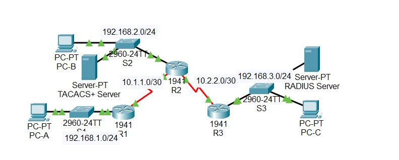
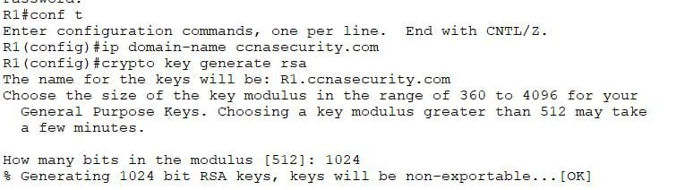
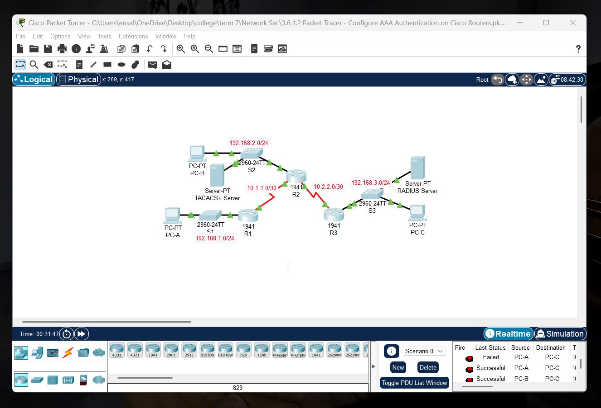

# Lab 03: Router Hardening and AAA Authentication

**Course:** CYS 502 Network Security | **Tool:** Cisco Packet Tracer | **Type:** Team lab

## Objective
Secure the management and control planes of Cisco routers: authenticate routing updates, synchronize and centralize logs, restrict remote access to SSH, and authenticate administrators locally and through TACACS+ and RADIUS servers.

## Part 1: OSPF MD5 Authentication
After testing baseline connectivity, message-digest authentication was enabled for OSPF area 0 on R1, R2, and R3, with an MD5 key on the serial interfaces. Routers now reject routing updates that are not signed with the shared key, which prevents rogue route injection.

| Connectivity | OSPF MD5 configuration | Verification |
|---|---|---|
|  |  |  |

## Part 2: NTP with Authentication
- R1–R3 configured as NTP clients of the server, with hardware-clock updates enabled
- NTP authentication with a trusted MD5 key, so routers only accept time from the authenticated server
- Log messages timestamped with date and milliseconds

Accurate, trusted time is essential for correlating logs during incident response.

## Part 3: Centralized Syslog
Each router was configured to send its log messages to a Syslog server. `show logging` confirmed remote logging, and messages from all three routers arrived on the server.

## Part 4: SSH-Only Remote Access on R3
| Step | Configuration |
|---|---|
| Domain name | Set, as required for RSA key generation |
| Local user | Admin account at privilege 15 with a secret password |
| VTY lines | Local login, SSH only |
| Keys | Existing keys erased, new 1024-bit RSA key pair generated |
| SSH settings | Version 2, 90-second timeout, 2 authentication retries |

**Verification:** Telnet from PC-C failed because the VTY lines accept SSH only. SSH from PC-C and from R2 succeeded.

## Part 5: AAA Authentication
| Router | Method | Fallback |
|---|---|---|
| R1 console | Local AAA | n/a |
| R1 VTY (SSH) | Named method list `SSH-LOGIN` | n/a |
| R2 console | **TACACS+** server | Local database |
| R3 console | **RADIUS** server | Local database |

Each router has a local backup account so administrators can still log in if the AAA server is unreachable.

| AAA topology | SSH-LOGIN method list |
|---|---|
|  |  |

All activities were verified as complete in Packet Tracer.

## Key Takeaways
- Authenticating OSPF and NTP protects the routing table and the time source from spoofing.
- Centralized, timestamped logging makes events traceable across devices.
- SSH-only VTY access removes cleartext Telnet credentials from the network.
- Server-based AAA centralizes administrator accounts, and a local fallback prevents lockout.
