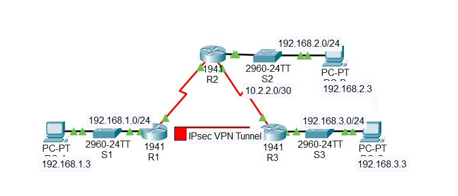
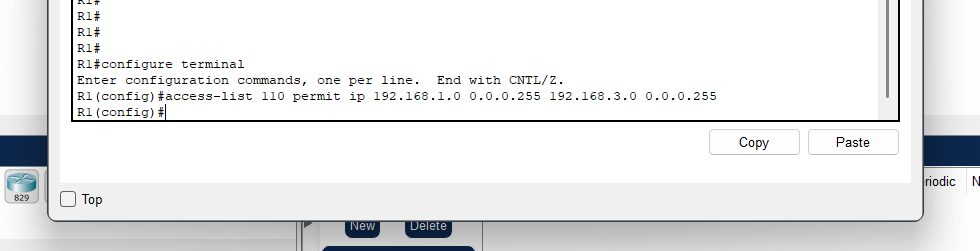
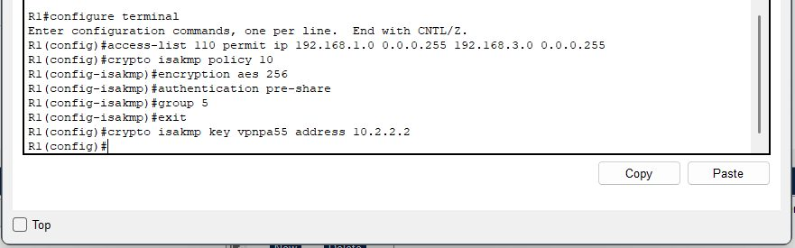
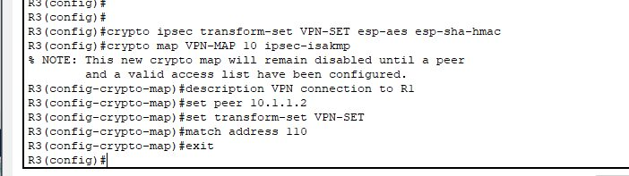
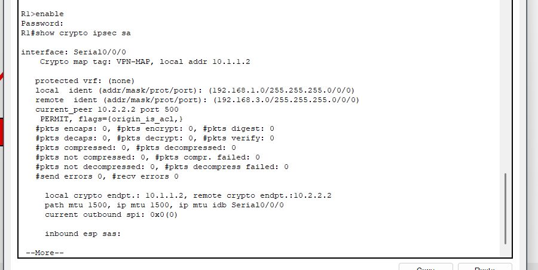
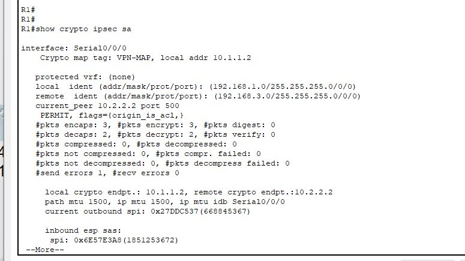
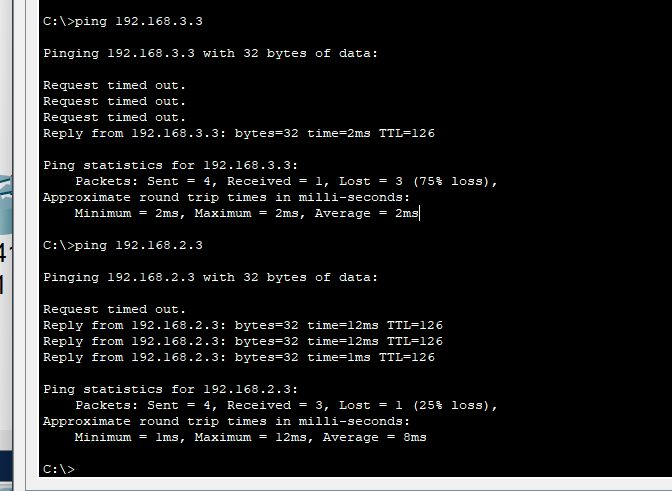
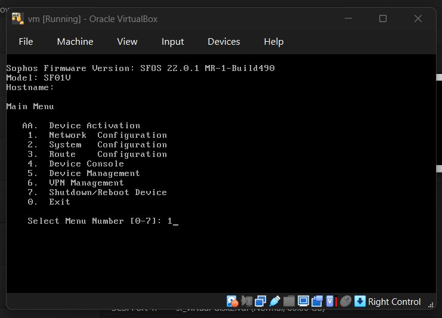

# Lab 05: IPsec VPN

**Course:** CYS 502 Network Security | **Tools:** Cisco Packet Tracer, Sophos XG Firewall, Sophos Connect, Wireshark | **Type:** Team lab

## Objective
Implement IPsec in two forms: a **site-to-site VPN** between two Cisco routers configured from the CLI, and a **remote-access VPN** on a Sophos XG Firewall.

## Part 1: Site-to-Site IPsec VPN (Packet Tracer)

### Topology
The tunnel runs between R1 (LAN 192.168.1.0/24) and R3 (LAN 192.168.3.0/24) through R2, which passes traffic without any VPN awareness.

### Configuration (on both R1 and R3)
| Component | Setting |
|---|---|
| License | `securityk9` technology package enabled |
| Interesting traffic | Extended ACL 110: LAN-to-LAN traffic only |
| IKE Phase 1 (ISAKMP policy 10) | AES-256, pre-shared key, DH group 5, 86,400 s lifetime |
| IKE Phase 2 (transform set `VPN-SET`) | `esp-aes esp-sha-hmac` |
| Crypto map `VPN-MAP` | Peer, transform set, and ACL 110, applied to the outgoing serial interface |

| ACL 110 | ISAKMP policy | Crypto map on R3 |
|---|---|---|
|  |  |  |

### Verification
| Test | `show crypto ipsec sa` result |
|---|---|
| Before any traffic | Encrypt/decrypt counters at 0 |
| Ping PC-A → PC-C (matches ACL 110) | Counters increased: traffic is encrypted |
| Ping PC-A → PC-B (doesn't match ACL 110) | Counters unchanged: traffic sent in the clear |

| Before traffic | After interesting traffic | Ping tests |
|---|---|---|
|  |  |  |

The Packet Tracer activity reached 100% completion.

## Part 2: Remote-Access IPsec VPN (Sophos XG Firewall)

1. **Deployment:** Imported the Sophos XG virtual appliance, configured host-only networks and adapters, completed initial setup, and activated an evaluation license.
2. **Access objects:** Enabled Ping and User Portal access, then created a VPN group, a VPN user, and an IP host object for the client address range.
3. **Policy:** Created a firewall rule allowing traffic from the VPN zone into the LAN.
4. **IPsec profile:** Configured remote-access IPsec with a pre-shared key, interface, client IP assignment range, and DNS settings.
5. **Client:** Exported the connection profile, imported it into Sophos Connect, and logged in with the VPN user's credentials.
6. **Validation:** The tunnel came up, ping and browser tests reached internal resources, and a Wireshark capture showed the traffic carried in **ESP** packets.

**Troubleshooting:** The Sophos VM was slow on first boot because of its CPU and RAM demands. Waiting for initialization to finish resolved it, and the web interface was then reachable.

## Key Takeaways
- IKE Phase 1 builds a secure channel; Phase 2 negotiates the SAs that protect the data.
- The interesting-traffic ACL decides what is encrypted. Anything that doesn't match travels unencrypted, not blocked.
- SA packet counters are the fastest way to prove a tunnel is actually encrypting traffic.
- ESP provides confidentiality, integrity, and anti-replay protection for tunneled traffic.
