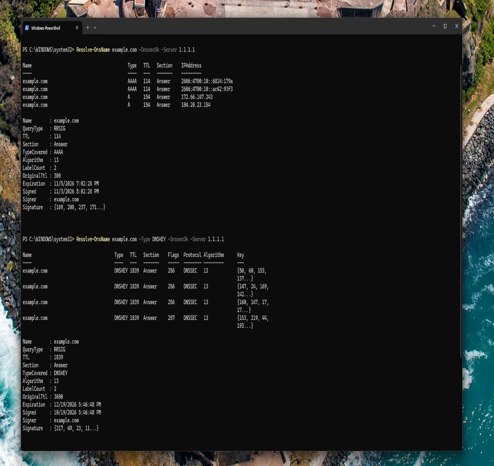
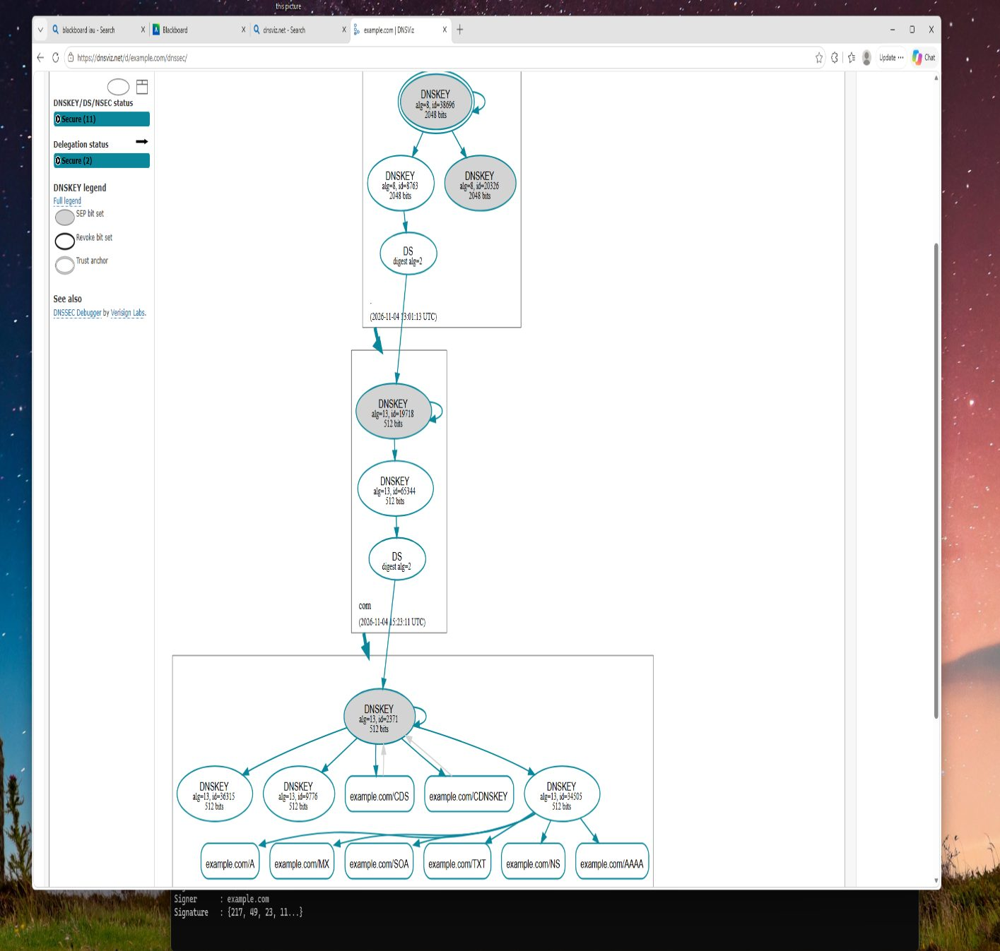

# DNSSEC Validation

**Course:** CYS 502 Network Security | **Tools:** PowerShell `Resolve-DnsName`, DNSViz

## Objective
Query DNSSEC records directly and visualize a domain's chain of trust to see how DNSSEC lets resolvers detect forged DNS answers.

## 1. Querying DNSSEC Records

```powershell
Resolve-DnsName example.com -DnssecOk -Server 1.1.1.1
Resolve-DnsName example.com -Type DNSKEY -DnssecOk -Server 1.1.1.1
```

| Query | What it returned |
|---|---|
| `A` / `AAAA` with `-DnssecOk` | The address records **plus RRSIG records**: the digital signatures covering them, with algorithm, signer, and validity period |
| `DNSKEY` | The zone's public keys (key-signing and zone-signing keys) used to verify those signatures |



## 2. Visualizing the Chain of Trust
DNSViz maps how trust flows from the root zone to the domain. Each zone's DNSKEY is vouched for by a DS record in its parent, from the root through `.com` to `example.com`. An unbroken chain means a validating resolver can prove an answer is authentic.



## Key Takeaways
- DNSSEC adds signatures (RRSIG) to DNS records; it provides integrity and authenticity, not confidentiality.
- DNSKEY records publish the keys, and DS records in the parent zone link each level of the chain.
- A validating resolver rejects answers whose signatures fail, which defeats DNS spoofing and cache poisoning.
