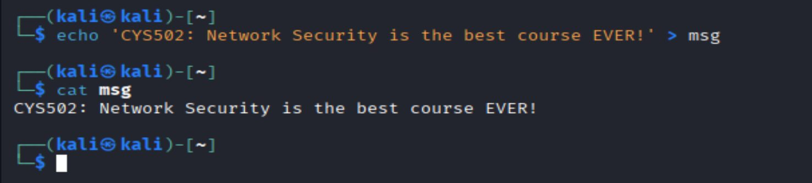

# OpenSSL and GPG: Public-Key Cryptography

**Course:** CYS 502 Network Security | **Tools:** OpenSSL, GnuPG, Kali Linux

## Objective
Generate and handle RSA key pairs with OpenSSL, and use GPG to build trust between users by signing each other's public keys.

## Part 1: RSA Key Pairs with OpenSSL

```bash
sudo apt install openssl
openssl genrsa -out rsa.private 1024                      # generate a 1024-bit private key
openssl rsa -in rsa.private -out rsa.public -outform PEM  # intended to export the public key
openssl rsa -in rsa.private -text                         # inspect the key components
```

The key was inspected with `-text`, showing its modulus, public exponent, primes, and other private components.

| Key generation | Key files |
|---|---|
|  |  |

### Lesson Learned: Exporting the Public Key
The export command above is missing `-pubout`, so `rsa.public` was written as a **second copy of the private key**. The file manager confirms this: it identifies `rsa.public` as a *Private RSA Key*. The correct command is:

```bash
openssl rsa -in rsa.private -pubout -out rsa.public -outform PEM
```

This mistake matters in practice. Sharing a file named "public" that actually contains the private key would expose it completely, so always check a key's type before distributing it (for example with `openssl rsa -pubin -in rsa.public -noout -text`).

Also, 1024-bit RSA is fine for a lab but too weak for real use. 2048 bits is the current minimum, and 3072 or more is recommended.

> Screenshots that print the full private key are intentionally not included. A private key should never be published, even a lab one.

## Part 2: Web of Trust with GPG

| Step | Command | Result |
|---|---|---|
| Review own keys | `gpg --list-secret-keys` | Ed25519 signing key and Curve25519 encryption subkey |
| Import a teammate's key | Imported from a keyserver | Teammate's public key added to the keyring |
| Verify and sign it | `gpg --sign-key <teammate>` | Fingerprint checked, then signed with my key |
| Check signatures | `gpg --check-sigs <teammate>` | **3 good signatures** (two self-signatures and mine) |

A test message file was also prepared for the encryption and signing exercises:

```bash
echo 'CYS502: Network Security is the best course EVER!' > msg
```



## Key Takeaways
- RSA public keys are derived from the private key, so only the public half should ever be shared, and you should verify what a key file contains before sending it.
- GPG uses modern elliptic-curve keys, Ed25519 for signing and Curve25519 for encryption.
- Signing someone's key after verifying its fingerprint is how the web of trust replaces a central certificate authority.
